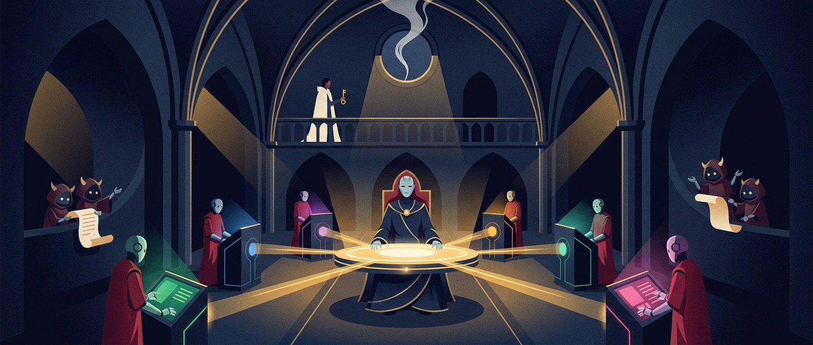
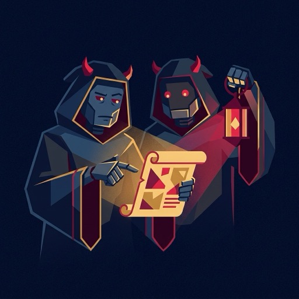
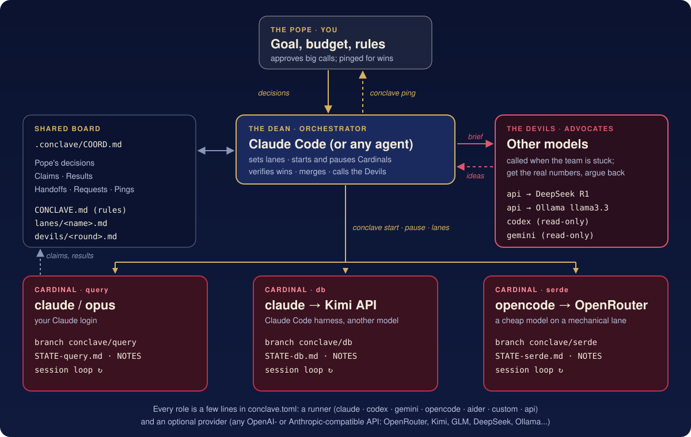
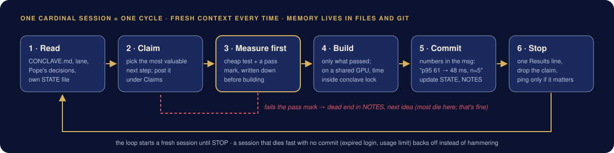

<p align="center">
  
</p>

<h1 align="center">Conclave</h1>

<p align="center">
  <b>A managed agent team for long, measurable goals.</b><br>
  One <b>Dean</b> orchestrates many <b>Cardinals</b> on any model. <b>Devils</b> argue back. You're the <b>Pope</b>.
</p>

<p align="center">
  <a href="#quickstart">Quickstart</a> ·
  <a href="#wire-each-role-to-any-model">Any model</a> ·
  <a href="#the-skills">Skills</a> ·
  <a href="#how-it-works">How it works</a> ·
  <a href="examples/">Examples</a>
</p>

---

You give it a goal with a number on it, like *"make search 2x faster"*, *"push this benchmark"* or
*"get this kernel under 50 µs"*. A team of coding agents then works on it for hours or days, each on
its own git branch. They measure before they build, write down every dead end, and check in with you
only for wins and real decisions.

It's not a swarm. A swarm is peers with no one in charge. A Conclave has a **hierarchy and a human
veto**, so it's an **agent team you manage**:

| | Role | Who plays it | What it does |
|---|---|---|---|
|  | **Pope** | **you** | Sets the goal, the finish line, the budget and the rules. Says yes or no to the big stuff. Gets pinged only for wins, decisions and "done". |
|  | **Dean** | your agent (Claude Code, Codex...) with the `conclave` skill | Splits the work into lanes, starts and pauses Cardinals, **verifies every claimed win**, merges, keeps the board, and calls the Devils when the team is stuck. |
|  | **Cardinals** | headless agent CLIs: `claude`, `codex`, `gemini`, `opencode`, `aider`, or your own | One lane each, on their own branch. Fresh short sessions in a loop. **Test before building.** Commits state the measured numbers. |
|  | **Devils** | *different* models, via any API | Devil's advocates. They get the team's real numbers and argue back: what's wrong with the plan, what nobody tried, what to stop doing. |

> **Born in a GPU kernel competition.** The Conclave ran three Cardinals for five nights on one shared
> H100 in the Open Kernel Challenge (2026). They built a full MoE decoder layer that measured
> **2.2x faster than SGLang** on the judge's H200. That setup ships as
> [`examples/gpu-kernel-race.toml`](https://github.com/tech-cosmos/conclave/blob/main/examples/gpu-kernel-race.toml).

<p align="center"></p>

## Quickstart

**You talk to your coding agent. It does the setup.** Install once:

```bash
uv tool install conclave-team          # the CLI (Python 3.11+, git; no other dependencies)
```

```
/plugin marketplace add tech-cosmos/conclave      # in Claude Code: the Dean skills
/plugin install conclave@conclave
```

Then, in the repo you want to improve, say:

> *Start a Conclave on making our search API 2x faster. Budget: 2 days and $40. Done when p95 is under 50 ms.*

Your agent becomes **the Dean**. It reads the repo, finds or writes the command that measures the goal,
records the baseline, picks a model for each role from the CLIs and keys you have, splits the work into
lanes, checks the setup and starts the Cardinals. It asks you **once**, and only for what it can't decide
itself: a missing finish line or budget, logins only you can do, gray-area rules.

After that, ask in plain words:

| You say | The Dean |
|---|---|
| *"How's the Conclave?"* | Best result vs baseline per lane, in five lines, with real numbers it re-checked. |
| *"Call the Devils."* | Briefs other models with the team's real numbers and brings back ideas worth testing. |
| *"Pause the Conclave."* / *"End the Conclave."* | Stops the Cardinals, checks every branch is pushed, writes the report. |
| *"Show me a Conclave demo."* | Runs `conclave demo`: a throwaway repo, one short Cardinal session, before/after. |

**What only you do:** log in to the agent CLIs and export API keys (they're your accounts), set the goal
and the budget, and say yes or no to the big calls. You get pinged for wins, real decisions and "done".

**Just want to see it work first?** `uvx --from conclave-team conclave demo` (nothing to install). It makes a
throwaway repo with one slow script, walks you through the setup with answers filled in, runs one Cardinal
for about a minute (a few cents on Claude Haiku), and prints the numbers before and after.

Not on Claude Code? Copy `skills/conclave` and `skills/conclave-setup` into your agent's skills folder
([details](#the-skills)), or drive the CLI yourself ([commands](#commands)).

## Wire each role to any model

Every role is a few lines in `conclave.toml`. Two ideas:

- **runner**: the program that plays the role. Cardinals need tools, so they use an agent CLI
  (`claude`, `codex`, `gemini`, `opencode`, `aider`, or `custom`). Devils can also be `api`: a plain
  chat call with no tools, which is the cheapest way to get a different brain.
- **provider**: where the model lives, and which env var holds the key. `kind = "openai"` covers any
  OpenAI-compatible URL (OpenAI, OpenRouter, Gemini, DeepSeek, Groq, Ollama, vLLM...). `kind = "anthropic"`
  covers Anthropic and Anthropic-compatible gateways. Set `provider` on a Cardinal and Conclave points
  its CLI at that API, so **Claude Code can drive Kimi, GLM or DeepSeek** and **Codex can drive any
  OpenAI-compatible model**.

```toml
[providers.openrouter]
kind = "openai"
base_url = "https://openrouter.ai/api/v1"
api_key_env = "OPENROUTER_API_KEY"

[providers.kimi]
kind = "anthropic"
base_url = "https://api.moonshot.ai/anthropic"
api_key_env = "MOONSHOT_API_KEY"

[[cardinals]]                  # hardest lane: strongest model, your Claude login
name = "query"
lane = "Query planning and the index lookup"
runner = "claude"
model = "opus"
paths = ["src/search/"]

[[cardinals]]                  # Claude Code's harness, Kimi's brain
name = "db"
runner = "claude"
provider = "kimi"
model = "kimi-k2-thinking"

[[cardinals]]                  # mechanical lane: a cheap model through opencode
name = "serde"
runner = "opencode"
model = "openrouter/qwen/qwen3-coder"

[[devils]]                     # a plain API call
name = "r1"
provider = "openrouter"
model = "deepseek/deepseek-r1"
persona = "a database engineer who thinks every latency problem is a missing index"

[[devils]]                     # an agent CLI as a Devil, run read-only so it can look at the code
name = "codex-devil"
runner = "codex"
```

Rule of thumb: **put the strongest model on the hardest lane, cheap models on mechanical lanes, and make
the Devils different model families from the Cardinals** so they don't share the same blind spots.
Full reference: [`skills/conclave-setup/SKILL.md`](https://github.com/tech-cosmos/conclave/blob/main/skills/conclave-setup/SKILL.md). Complete configs:
[`examples/`](https://github.com/tech-cosmos/conclave/tree/main/examples).

## The skills

Two [Agent Skills](https://docs.claude.com/en/docs/claude-code/skills) ship with the repo:

| Skill | Use it for |
|---|---|
| [`conclave`](https://github.com/tech-cosmos/conclave/blob/main/skills/conclave/SKILL.md) | Makes your agent **the Dean**: understands "Start a Conclave...", "How's the Conclave?", "Call the Devils", "Pause/End the Conclave". |
| [`conclave-setup`](https://github.com/tech-cosmos/conclave/blob/main/skills/conclave-setup/SKILL.md) | Installing, wiring roles to models and keys, remote GPU boxes, fixing `conclave doctor`. |

**Claude Code** (plugin):

```
/plugin marketplace add tech-cosmos/conclave
/plugin install conclave@conclave
```

On Claude Code 2.1.275 or later, one line does both: `/plugin install conclave --marketplace tech-cosmos/conclave`

**Other agents**: copy `skills/conclave` and `skills/conclave-setup` into your agent's skills folder.
For Codex that's `~/.codex/skills/`. `conclave dean` also opens your configured Dean with its playbook
(`.conclave/DEAN.md`) already loaded.

## How it works

<p align="center"></p>

**Memory lives in files and git, never in a chat context.** Each Cardinal session starts fresh, reads its
briefs, does one cycle (45-90 min), commits, writes notes and exits. The loop starts the next session, so
a Cardinal can run for days without its context filling up or drifting.

```
conclave.toml              every role → runner / model / provider; compute; loop settings
.conclave/
  CONCLAVE.md              the rules every Cardinal reads first (yours to edit)
  DEAN.md                  the Dean's playbook, filled in for this Conclave
  COORD.md                 the shared board: Pope's decisions · Claims · Results · Handoffs · Requests · Pings
  lanes/<name>.md          one brief per Cardinal
  worktrees/<name>/        each Cardinal's checkout on branch conclave/<name>, with STATE-<name>.md and NOTES-<name>.md
  devils/<round>.md        every Devils round, answers side by side
  logs/                    loop logs and full session transcripts
```

What's built in, so you don't have to ask:

- **Test before building.** Every idea gets a cheap measurement and a pass mark first. Most die there,
  and get logged as dead ends so nobody tries them twice.
- **Every Cardinal keeps its own git trail**: its own branch, a one-page `STATE`, a long `NOTES` log,
  commits that state the measured numbers, pushed after every session.
- **The board is safe for concurrent writers.** It uses a file lock and atomic replace, so ten Cardinals
  writing at once lose nothing.
- **An idle Cardinal gets paused**, not handed busywork.
- **Back-off.** A session that dies in seconds without a commit (expired login, usage limit, outage)
  backs off instead of burning the budget.
- **Shared hardware.** `conclave lock gpu -- python bench.py` serializes timing runs, so numbers from
  Cardinals sharing one GPU stay clean.
- **The Pope's veto.** Rule changes, deletions, anything public, new logins and overspending all go to you first.

## Commands

| Command | What it does |
|---|---|
| `conclave demo [dir]` | Try it: a throwaway repo with a slow script, the wizard pre-filled, one short Cardinal session, before/after numbers. |
| `conclave init` | Wizard: writes `conclave.toml` and `.conclave/`. Detects installed CLIs and API keys. `--yes` for no questions. |
| `conclave doctor [--ping]` | Checks git, runners and keys; `--ping` makes one tiny call per Devil provider. |
| `conclave start [names]` / `resume` | Start (or restart) Cardinal loops in the background. |
| `conclave status [--json]` | Who's working, sessions, last commits, claims, requests, pings. |
| `conclave devils "<brief>" [-f file] [--only name]...` | One Devils round, in parallel. Answers land in `.conclave/devils/`. |
| `conclave pause [names] [--now]` | Stop after the current session (`--now` kills it). Warns about unpushed work. |
| `conclave end [--out path]` | Stop everything, check every branch is pushed, write the report (e.g. into your Obsidian vault). |
| `conclave ping "<msg>"` | Notify the Pope: desktop, phone (`ntfy:<topic>`) or any command. |
| `conclave board <Section> "<line>"` | Append a line to COORD.md (Cardinals use this). |
| `conclave lock <name> -- <cmd>` | Run a command holding a shared lock (one GPU, one judge). |
| `conclave logs <name>` | Tail a Cardinal's latest session transcript. |
| `conclave dean` | Open your Dean agent with the playbook loaded. |

## Remote compute (GPU boxes, sandboxes)

Clone the repo on the box, install `conclave` there, and log the agent CLIs in there (only you can do that
part). Then, locally:

```toml
[compute]
backend = "remote"
exec_prefix = ["ssh", "gpu-box"]   # anything that runs a command on the box
remote_dir = "~/myrepo"
locks = ["gpu"]
```

Every command except `init` and `dean` is forwarded to the box. Set `[pope] notify = "ntfy:<topic>"` so pings
reach your phone. **Cloud sandboxes are sometimes deleted when stopped**, so run `conclave end` first: it warns
about anything unpushed.

## Safety

Cardinals run unattended **with full permissions in their worktree** (`claude --dangerously-skip-permissions`,
`codex --dangerously-bypass-approvals-and-sandbox`, `gemini --yolo`). That's what makes overnight runs
possible, and it also means they can run any command your user can. **Run Conclaves in a container, VM or
cloud sandbox** unless you trust the repo and the lanes. Keep secrets out of the box, and set a budget
your provider dashboards enforce. Devils that run on an agent CLI are started read-only.

## Status

`v0.1`: the loop, the board, the Devils, the skills, and local and remote compute all work. They're covered by
tests that use a stand-in agent (`python -m unittest discover tests`), and were checked end to end with real
Claude Code Cardinals and OpenRouter Devils. Next up: a live web view of the board, cost tracking per
Cardinal, and first-class Daytona/Modal backends. Issues and PRs are welcome.

## License

MIT
